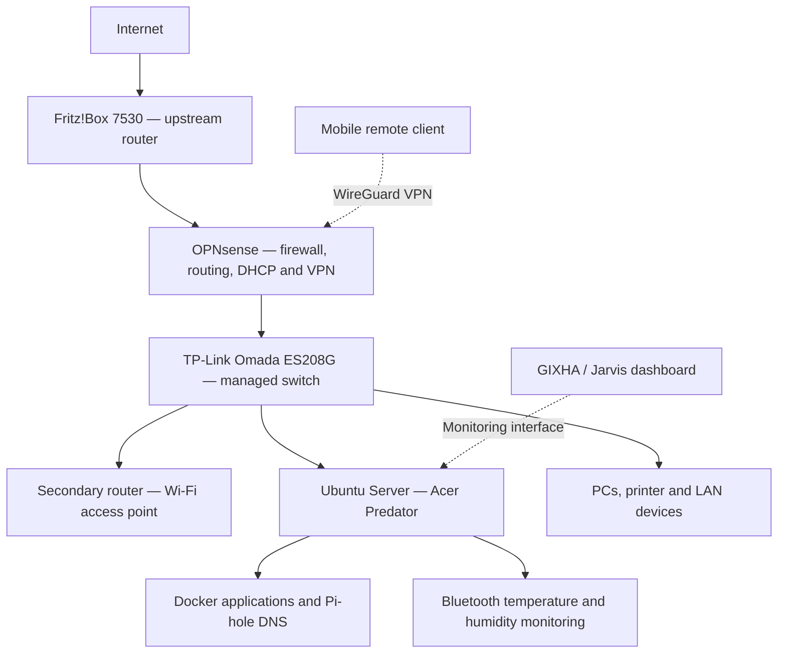

# Home Lab — Network Infrastructure & Self-Hosted Services

A hands-on home infrastructure project built and configured with Linux, OPNsense, managed switching, secure VPN access, Docker, DNS filtering, and environmental monitoring.

## Infrastructure Overview

**Network implementation:** OPNsense provides the firewall boundary for the internal LAN; the managed switch connects internal devices and the server. Because the firewall laptop uses a shared physical interface, the same switch also carries the separate upstream WAN path using VLAN 100, while LAN ports remain separated. The diagram above shows the **logical network flow**, not the exact physical cabling.

## Hardware

| Component | Setup |
| --- | --- |
| Server | Acer Predator PH317-51, Intel Core i7-7700HQ, 16 GB RAM |
| Server operating system | Ubuntu Server 26.04 LTS |
| Storage | 1 TB NVMe system drive + 512 GB SSD for service data |
| Firewall | Samsung laptop with OPNsense |
| Managed switch | TP-Link Omada ES208G, 8 ports |
| Internet router | Fritz!Box 7530 |
| Internal wireless | Secondary router configured in access-point mode |

## Implemented Infrastructure

### OPNsense Firewall & Networking
- Installed and configured OPNsense as the dedicated firewall and router for the internal network.
- Configured firewall rules, NAT, DHCP service, DNS resolution with Unbound, and a server DHCP reservation.
- Configured the Omada switch with **VLAN 100 for the upstream WAN path** and LAN port assignments, using a shared connection to OPNsense.
- Configured the secondary router as a Wi-Fi access point with DHCP disabled.
- Connected the Ubuntu Server, client devices, and printer to the protected LAN.

### WireGuard VPN & Remote Access
- Configured a WireGuard VPN endpoint on OPNsense.
- Created a mobile peer using QR-code import and configured on-demand VPN behavior.
- Connected remotely over VPN and accessed the Ubuntu Server using SSH.
- Configured SSH key authentication for server administration.
- Used Tailscale as an additional private remote-access tool.

### Pi-hole DNS Filtering
- Deployed Pi-hole in Docker on Ubuntu Server.
- Configured upstream resolvers and domain filtering.
- Verified DNS blocking against test domains.
- Configured and tested Pi-hole DNS usage with LAN clients and OPNsense DHCP/DNS settings.

### Ubuntu Server & Docker
- Installed Ubuntu Server on the NVMe drive and mounted the additional SSD for persistent service data.
- Set up SSH administration, stable DHCP addressing, and remote access.
- Deployed Docker-based services, including the Nlocki application stack with API and database.
- Configured persistent storage and automatic restart policies for containers.
- Verified application recovery after server restarts.

### Environmental Monitoring
- Connected two Bluetooth temperature/humidity sensors for the living room and bedroom.
- Integrated their readings into the local monitoring workflow.
- Tested measurement updates and persistence of humidity alert state across restarts.

## Security Implemented

- **Network firewall:** OPNsense protects the internal LAN and applies firewall and NAT rules.
- **WAN/LAN separation:** The managed switch carries WAN traffic on VLAN 100 and separates it from LAN port assignments.
- **Encrypted remote access:** WireGuard VPN on OPNsense provides access to internal network resources.
- **SSH authentication:** SSH keys are configured for remote Ubuntu Server administration.
- **Internal DNS:** Unbound and Pi-hole are configured for local DNS resolution and filtering.
- **Private service access:** Server applications are administered through the internal network and authenticated remote access.

## GIXHA / Jarvis — Home Lab Dashboard

GIXHA (Jarvis) is my private AI-assistant and dashboard project for a centralized view of the Home Lab. The dashboard work includes infrastructure status and environmental sensor readings, providing a single interface for observing the server and connected services.

The assistant's conversational features are developed in the separate [gix-jarvis repository](https://github.com/ilirgashii/gix-jarvis). Full automated control of every Home Lab device and service is **not** presented as completed functionality.

**Portfolio:** [gixha.com](https://gixha.com)
