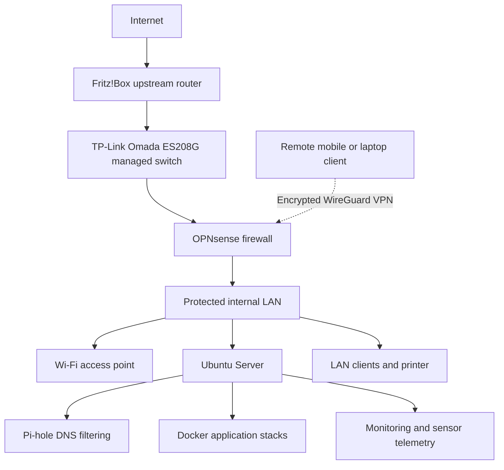

# Home Lab — Network Security, Linux & Self-Hosted Infrastructure

A practical self-hosted infrastructure lab built with repurposed hardware to develop and demonstrate hands-on skills in network engineering, Linux administration, secure remote access, DNS services, container operations, and monitoring.

> **Portfolio note:** This repository describes architectural concepts and completed lab activities. It intentionally excludes IP addresses, private VPN keys, credentials, access tokens, and exported device configurations.

## Infrastructure Overview

**Network design:** The switch uses VLAN-aware port assignments to carry upstream/WAN and internal-LAN paths while OPNsense performs firewalling and routing. The upstream router continues serving its own network; the second router acts as an access point with DHCP disabled. The diagram is logical rather than a complete physical port/cabling map.

## Hardware and Platform

| Role | Equipment / Software |
| --- | --- |
| Main host | Acer Predator PH317-51, Intel Core i7-7700HQ, 16 GB RAM |
| Server OS | Ubuntu Server 26.04 LTS |
| Server storage | 1 TB NVMe system drive + separate 512 GB SSD for data |
| Firewall | Dedicated Samsung laptop running OPNsense |
| Managed switch | TP-Link Omada ES208G, 8 ports |
| Upstream router | Fritz!Box 7530 family |
| Internal wireless | Secondary router operating as access point |
| Application platform | Docker and Docker Compose |

## Projects and Completed Work

### 1. OPNsense Firewall and Segmented Networking
- Installed and configured a dedicated OPNsense firewall between upstream connectivity and the protected LAN.
- Configured a VLAN-capable managed switch with a separate WAN transport VLAN (VLAN 100) and LAN port assignments.
- Implemented internal DHCP services, host reservations, DNS integration, and firewall/NAT rules.
- Configured a secondary Wi-Fi router in access-point mode with DHCP disabled.
- Tested LAN routing, client connectivity, and access to internal services.

### 2. WireGuard VPN — Secure Remote Administration
- Configured a WireGuard VPN server on OPNsense and imported a mobile client using a QR-based peer configuration.
- Tested encrypted remote access to internal resources and SSH access to the Ubuntu Server.
- Used key-based SSH authentication and tested VPN access from mobile connectivity and Wi-Fi.
- Configured mobile on-demand VPN behavior during lab testing.

**Security design:** Remote administrative access is protected by VPN and SSH authentication. No private keys, public IPs, peer addresses, or operational firewall exports are published here.

### 3. Pi-hole DNS and Network Filtering
- Deployed Pi-hole as a Docker-based DNS filtering service on the Ubuntu Server.
- Configured upstream DNS resolvers and tested domain filtering.
- Tested LAN DNS client settings and DHCP/DNS integration through OPNsense.
- Investigated DNS resolution and mobile-client behavior during troubleshooting.

**Status:** Core Pi-hole filtering was verified in lab tests; some mobile/automatic-DNS scenarios remained under investigation and are not presented as fully resolved.

### 4. Ubuntu Server and Container Operations
- Installed Ubuntu Server and configured an additional SSD for persistent service data.
- Configured SSH-key administration and stable server addressing through DHCP reservation.
- Deployed a multi-service application stack with frontend/backend components and a database using Docker.
- Configured container restart policies and tested recovery after host restarts.
- Performed basic troubleshooting through Docker logs, networking tools, and service checks.

### 5. Monitoring, Sensors, and Automation
- Integrated temperature and humidity readings from two Bluetooth sensors into local monitoring experiments.
- Tested alert state persistence and avoidance of duplicate notifications after server restarts.
- Worked on a private AI assistant project (**GIX Jarvis**) for infrastructure visibility and automation.
- Kept Home Assistant stopped during the tested sensor-monitoring workflow.

**Scope:** Monitoring and AI features are evolving projects; external messaging, email ingestion, and other integrations should only be considered complete after separate end-to-end verification.

## Skills Demonstrated

| Area | Practical Experience |
| --- | --- |
| Networking | TCP/IP, routing, VLAN-aware switching, DHCP, DNS, access points |
| Security | OPNsense firewall, NAT, WireGuard VPN, SSH keys |
| Linux | Ubuntu Server, storage mounts, service troubleshooting, remote administration |
| Containers | Docker, Docker Compose, persistent data, restart policies, logs |
| Operations | Connectivity testing, DNS troubleshooting, maintenance and restart validation |
| Monitoring | Bluetooth sensor readings, environmental alerts, service visibility |

## Troubleshooting Examples

- Validated VPN connectivity and SSH access from a mobile device.
- Tested DNS queries and Pi-hole filtering while isolating issues with client DNS settings.
- Verified network segmentation and connectivity after changes to switch/firewall/AP configuration.
- Tested service recovery after Ubuntu Server restarts.

## Security and Privacy

This is a **sanitized public overview**, not a deployment guide for the production home network.

- Do not commit `.env` files, authentication secrets, WireGuard keys, or credentials.
- Do not commit exported OPNsense/managed-switch configuration backups.
- Do not publish home-network addressing, public endpoints, private hostnames, or detailed firewall policies.
- Store any future configuration samples as generic, fictional examples only.

## Roadmap

- Continue validating mobile DNS and Pi-hole behavior across client networks.
- Improve monitoring dashboards, alerting, and service health checks.
- Implement and test reproducible backups and restore procedures.
- Document recovery runbooks and strengthen least-privilege access.
- Expand automated checks and CI where appropriate.

---

**Focus:** IT Administration · Linux · Network Engineering · Cloud Infrastructure · Security · Automation

**Related portfolio:** [gixha.com](https://gixha.com)
